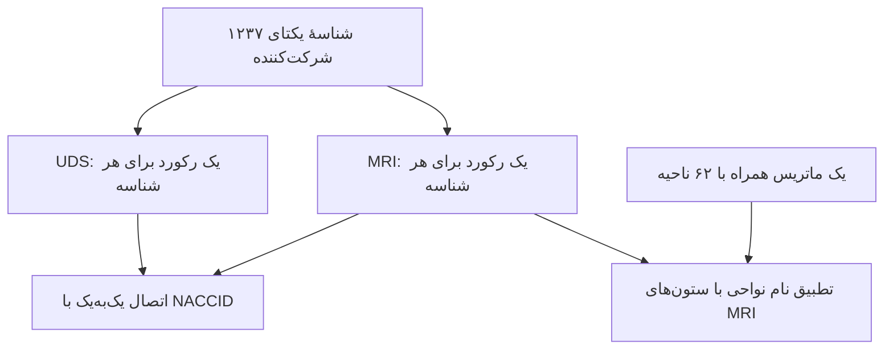

# نقشهٔ کامل داده‌های پروژه — فاز یک، مسیر ج

تاریخ بررسی: ۲۰۲۶-۱۰-۳۱. دامنهٔ بررسی مرحلهٔ ۴ در این سند: سه CSV تحویلی TA؛ در آن مرحله پاک‌سازی، حذف، اتصال ذخیره‌شده یا محاسبهٔ رابطه انجام نشد. وضعیت مراحل بعد در بند زیر آمده است.

این سند، ساختار و مشاهدات خام مرحلهٔ ۴ را ثبت می‌کند. [فرهنگ متغیرهای منتخب](SELECTED_VARIABLES.md) تعریف دقیق سؤال را تکمیل می‌کند. در مرحلهٔ ۵، [قواعد کیفیت](QUALITY_RULES.md) تعیین و [ممیزی قابل بازتولید](../reports/phase1/quality_audit.md) اجرا شده است؛ در مرحلهٔ ۶، [اتصال ذخیره‌شده و جریان نمونه](../reports/phase1/sample_flow.md) با همان کلیدها تکمیل شده است؛ [راهنمای دادهٔ مشتق](../data/README.md) قرارداد جدول جدید را دارد. داده‌های اولیه همچنان دست‌نخورده‌اند.

## ۱. سه سطح متفاوت داده

| فایل | ردیف داده | ستون | واحد هر ردیف | کلید/برچسب |
|---|---:|---:|---|---|
| UDS | ۱۲۳۷ | ۱۸۰ | رکورد یک شرکت‌کننده در فایل تحویلی | NACCID |
| MRI | ۱۲۳۷ | ۱۲۶ | رکورد اندازه‌گیری‌های یک شرکت‌کننده | NACCID |
| ماتریس همراه | ۶۲ | ۶۳ شامل ستون نام ردیف | یک ناحیهٔ مغز | نام ناحیه؛ نه NACCID |

شمارهٔ ستون‌ها و موقعیت نواحی در این سند از **۱** شروع می‌شود. ردیف سرستون جزو ردیف‌های داده نیست. تعداد ۶۳ در فایل ماتریس، ۶۲ ستون عددی به‌علاوهٔ ستون برچسب ردیف است؛ نه ماتریس ۶۲×۶۳.

## ۲. ساختار شرکت‌کننده و ارتباط فایل‌ها

- شناسهٔ تکراری یا شناسهٔ مختص فقط یکی از دو فایل دیده نشد؛ اشتراک ۱۲۳۷ است.
- وجود رکورد در هر دو فایل، کامل یا معتبر بودن تمام مقادیر آن فرد را ثابت نمی‌کند.
- NACCUDSD در هر دو فایل است و مقادیر آن برای هر شناسه، با مقایسهٔ عددی، یکسان است. هنگام اتصال، نسخهٔ UDS نگهداری و سازگاری کنترل شده است.
- ترتیب فعلی شناسه‌ها یکسان است، ولی دلیل اتصال نیست؛ اتصال کلیدمحور و با کنترل یک‌به‌یک انجام شده است.
- داشتن یک رکورد در فایل فعلی، فقط ساختار همین فایل را نشان می‌دهد. تعداد مراجعه‌ها و قاعدهٔ انتخاب رکورد در منبع معلوم نیست؛ «اولین مراجعه»، «آخرین مراجعه» یا «میانگین مراجعه‌ها» به داده نسبت داده نمی‌شود.
- هر شناسه در تحلیل اصلی حداکثر یک واحد تحلیلی دارد. این قاعده از ورود تکراری همان فرد جلوگیری می‌کند؛ یکتایی شناسه به‌تنهایی اثبات استقلال همهٔ افراد، مراکز یا خانواده‌ها نیست. اطلاعات مرکز/خوشه در فایل فعلی در دسترس نیست.

## ۳. پوشش همهٔ ستون‌های UDS

دسته‌بندی زیر برای سازمان‌دهی این پروژه است. کد فرم، محل تعریف متغیر متناظر در مستندات عمومی را نشان می‌دهد؛ از آن نمی‌توان نسخه یا فرم واقعی رکوردهای تحویلی را اثبات کرد. وجود NACCAPOE در CSV موسوم به UDS، آن را به متغیر کمی تبدیل نمی‌کند؛ تعریف آن در مرجع ژنتیک است.

| دسته | تعداد ستون | بخش مرجع | ستون‌ها |
|---|---:|---|---|
| شناسه | 1 | سرآیند | `NACCID` |
| جمعیت‌شناختی و وضعیت زندگی | 12 | A1 | `SEX`، `HISPANIC`، `HISPOR`، `RACE`، `PRIMLANG`، `EDUC`، `MARISTAT`، `NACCLIVS`، `INDEPEND`، `RESIDENC`، `NACCNIHR`، `NACCAGE` |
| سابقهٔ خانوادگی و شواهد جهش | 11 | A3 | `NACCFAM`، `NACCMOM`، `NACCDAD`، `NACCAM`، `NACCAMS`، `NACCFM`، `NACCFMS`، `NACCOM`، `NACCOMS`، `NACCFADM`، `NACCFFTD` |
| دارو و شاخص‌های دارویی | 21 | A4 | `ANYMEDS`، `NACCAAAS`، `NACCAANX`، `NACCAC`، `NACCACEI`، `NACCADEP`، `NACCAHTN`، `NACCAMD`، `NACCANGI`، `NACCAPSY`، `NACCBETA`، `NACCCCBS`، `NACCDBMD`، `NACCDIUR`، `NACCEMD`، `NACCEPMD`، `NACCHTNC`، `NACCLIPL`، `NACCNSD`، `NACCPDMD`، `NACCVASD` |
| سابقهٔ دخانیات | 5 | A5 | `TOBAC30`، `TOBAC100`، `SMOKYRS`، `PACKSPER`، `QUITSMOK` |
| سابقهٔ قلبی | 7 | A5 | `CVHATT`، `CVAFIB`، `CVANGIO`، `CVBYPASS`، `CVPACDEF`، `CVCHF`، `CVOTHR` |
| عصبی، عروقی و آسیب مغزی | 8 | A5 | `CBSTROKE`، `CBTIA`، `SEIZURES`، `NACCTBI`، `TBI`، `TBIBRIEF`، `TBIEXTEN`، `TBIWOLOS` |
| متابولیک و سایر سوابق جسمی | 14 | A5 | `DIABETES`، `DIABTYPE`، `HYPERTEN`، `HYPERCHO`، `B12DEF`، `THYROID`، `ARTHRIT`، `ARTHTYPE`، `ARTHUPEX`، `ARTHLOEX`، `ARTHSPIN`، `ARTHUNK`، `INCONTU`، `INCONTF` |
| خواب | 4 | A5 | `APNEA`، `RBD`، `INSOMN`، `OTHSLEEP` |
| روان‌پزشکی و مصرف مواد | 11 | A5 | `ALCOHOL`، `ABUSOTHR`، `PTSD`، `BIPOLAR`، `SCHIZ`، `DEP2YRS`، `DEPOTHR`، `ANXIETY`، `OCD`، `NPSYDEV`، `PSYCDIS` |
| معاینهٔ جسمی و حواس | 12 | B1 | `HEIGHT`، `WEIGHT`، `BPSYS`، `BPDIAS`، `HRATE`، `VISION`، `VISCORR`، `VISWCORR`، `HEARING`، `HEARAID`، `HEARWAID`، `NACCBMI` |
| خلاصهٔ معاینهٔ عصبی | 2 | B8 | `NACCNREX`، `NORMEXAM` |
| رفتاری و علائم NPI-Q | 25 | B5 | `NPIQINF`، `DEL`، `DELSEV`، `HALL`، `HALLSEV`، `AGIT`، `AGITSEV`، `DEPD`، `DEPDSEV`، `ANX`، `ANXSEV`، `ELAT`، `ELATSEV`، `APA`، `APASEV`، `DISN`، `DISNSEV`، `IRR`، `IRRSEV`، `MOT`، `MOTSEV`، `NITE`، `NITESEV`، `APP`، `APPSEV` |
| خلق و مقیاس GDS | 17 | B6 | `NOGDS`، `SATIS`، `DROPACT`، `EMPTY`، `BORED`، `SPIRITS`، `AFRAID`، `HAPPY`، `HELPLESS`، `STAYHOME`، `MEMPROB`، `WONDRFUL`، `WRTHLESS`، `ENERGY`، `HOPELESS`، `BETTER`، `NACCGDS` |
| فعالیت‌های روزمره و عملکرد | 10 | B7 | `BILLS`، `TAXES`، `SHOPPING`، `GAMES`، `STOVE`، `MEALPREP`، `EVENTS`، `PAYATTN`، `REMDATES`، `TRAVEL` |
| گزارش افت حافظه | 1 | B9 | `DECSUB` |
| آزمون‌های شناختی و عصب‌روان‌شناختی | 9 | C1/C2؛ MoCA در C2 | `ANIMALS`، `VEG`، `TRAILA`، `TRAILARR`، `TRAILALI`، `TRAILB`، `TRAILBRR`، `TRAILBLI`، `MOCATOTS` |
| ژنتیک APOE | 1 | RDD-Gen | `NACCAPOE` |
| وضعیت شناختی تشخیصی | 1 | D1 | `NACCUDSD` |
| CDR و حوزه‌های آن | 8 | B4 | `MEMORY`، `ORIENT`، `JUDGMENT`، `COMMUN`، `HOMEHOBB`، `PERSCARE`، `CDRSUM`، `CDRGLOB` |

جمع دسته‌ها **۱۸۰** است؛ هر ستون دقیقاً یک بار در دسته‌بندی قرار دارد. فهرست به ترتیب واقعی فایل در پیوست الف آمده است.

### نکات تفسیر دسته‌ها

- دستهٔ دارو ترکیبی از شاخص‌ها و شمارش‌هاست؛ از برچسب دسته نمی‌توان نوع یکسانی برای تمام ستون‌ها نتیجه گرفت.
- در ستون‌های سابقهٔ بیماری، منبع شواهد، وضعیت زندگی، علائم و شدت علائم، معنی هر کد باید جدا خوانده شود؛ تمام آن‌ها دودویی نیستند.
- CDR و حوزه‌های آن با تشخیص علت آلزایمر یا MoCA یکی نیستند؛ در مدل اصلیِ فعلی به‌عنوان پیش‌بین اضافه نشده‌اند.
- مدت، شمارش، نمره و کد خطا در بخش آزمون‌ها با هم مخلوط‌اند. مقیاس و واحد باید در صورت ورود هر متغیر به تحلیل جداگانه مستند شود.
- REMDATES ستون تاریخ مراجعه نیست؛ در بخش عملکرد قرار دارد. جست‌وجوی واژهٔ DATE در نام ستون به‌تنهایی راه شناسایی فرادادهٔ زمانی نیست.
- NACCNREX و NORMEXAM جهت کدگذاری یکسانی ندارند. تفسیر «۱ یعنی معاینهٔ طبیعی» را نمی‌توان برای هر دو به کار برد. این دو در سؤال اصلی منتخب نیستند.
- NACCAPOE در مرجع ژنتیک کد ژنوتیپ است؛ کد ۹ به دادهٔ نامعلوم/ناموجود/ارزیابی‌نشده اشاره دارد و این ستون تعداد آلل e4 نیست. شمارش آلل، متغیر متفاوتی در مرجع است. در دادهٔ فعلی ۲۷۸ مورد کد ۹ دارد؛ وارد تحلیل اصلی نشده است.
- نمونه‌های متغیر منتخب و نقش آن‌ها در سند فرهنگ آمده‌اند؛ سایر ستون‌ها صرفاً به‌خاطر در دسترس بودن وارد تحلیل نمی‌شوند.

## ۴. ساختار تمام ستون‌های MRI

- از ۱۲۶ ستون، دو ستون NACCID و NACCUDSD فرادادهٔ فرد/گروه‌اند؛ ۱۲۴ ستون اندازه‌گیری داریم.
- ۳۱ نام ناحیه برای هر نیمکره، یعنی ۶۲ ناحیهٔ دارای سمت، وجود دارد؛ برای هر ناحیهٔ دارای سمت دو اندازه‌گیری ثبت شده است.
- برای هر نام ناحیه دقیقاً این چهار ترکیب موجود است: LH/RH × GVOL/AVGTH؛ ستون ترکیب‌شده یا سمت گمشده در سرستون‌ها دیده نشد.
- GVOL و AVGTH دو کمیت متفاوت‌اند؛ جمع‌زدن یا میانگین‌گرفتن آن‌ها با یکدیگر تعریف نشده است. واحدهای متناظر در فرهنگ مرجع mm³ و mm هستند.
- دادهٔ تحویلی عددهای استخراج‌شده از تصویربرداری است؛ فایل تصویر خام، voxel، سطح قشر یا فایل QC همراه در این پوشه نیست.
- نام‌گذاری با فرهنگ SCAN & CLARiTI سازگار است، ولی پروتکل تصویربرداری، نسخهٔ FreeSurfer، اطلس واقعی استفاده‌شده توسط تهیه‌کننده و انجام QC این زیرمجموعه تأیید نشده‌اند. تاریخ شروع SCAN در منابع به این فایل نسبت داده نمی‌شود.

### ۳۱ نام ناحیه و تطبیق با ماتریس

این تطبیق بر اساس نام‌هاست، نه برابر بودن موقعیت ستون. موقعیت عددی ماتریس در جدول زیر از ۱ تا ۶۲ است و ستون برچسب ردیف را حساب نمی‌کند. ردیف‌های MRI افرادند؛ موقعیت ناحیه در ماتریس، شمارهٔ ردیف یک فرد در MRI نیست.

| نام پایهٔ MRI | برچسب ماتریس چپ | موقعیت | برچسب ماتریس راست | موقعیت |
|---|---|---:|---|---:|
| `CAUDALANTERIORCINGULATE` | `left_caudal_anterior_cingulate` | 17 | `right_caudal_anterior_cingulate` | 32 |
| `CAUDALMIDDLEFRONTAL` | `left_caudal_middle_frontal` | 1 | `right_caudal_middle_frontal` | 53 |
| `CUNEUS` | `left_cuneus` | 18 | `right_cuneus` | 33 |
| `ENTORHINAL` | `left_entorhinal` | 19 | `right_entorhinal` | 34 |
| `FUSIFORM` | `left_fusiform` | 2 | `right_fusiform` | 35 |
| `INFERIORPARIETAL` | `left_inferior_parietal` | 3 | `right_inferior_parietal` | 54 |
| `INFERIORTEMPORAL` | `left_inferior_temporal` | 4 | `right_inferior_temporal` | 36 |
| `ISTHMUSCINGULATE` | `left_isthmus_cingulate` | 20 | `right_isthmus_cingulate` | 37 |
| `LATERALOCCIPITAL` | `left_lateral_occipital` | 5 | `right_lateral_occipital` | 38 |
| `LATERALORBITOFRONTAL` | `left_lateral_orbitofrontal` | 6 | `right_lateral_orbitofrontal` | 39 |
| `LINGUAL` | `left_lingual` | 21 | `right_lingual` | 40 |
| `MEDIALORBITOFRONTAL` | `left_medial_orbitofrontal` | 22 | `right_medial_orbitofrontal` | 41 |
| `MIDDLETEMPORAL` | `left_middle_temporal` | 7 | `right_middle_temporal` | 55 |
| `PARAHIPPOCAMPAL` | `left_parahippocampal` | 23 | `right_parahippocampal` | 42 |
| `PARACENTRAL` | `left_paracentral` | 24 | `right_paracentral` | 43 |
| `PARSOPERCULARIS` | `left_pars_opercularis` | 28 | `right_pars_opercularis` | 59 |
| `PARSORBITALIS` | `left_pars_orbitalis` | 29 | `right_pars_orbitalis` | 60 |
| `PARSTRIANGULARIS` | `left_pars_triangularis` | 30 | `right_pars_triangularis` | 61 |
| `PERICALCARINE` | `left_pericalcarine` | 31 | `right_pericalcarine` | 62 |
| `POSTCENTRAL` | `left_postcentral` | 8 | `right_postcentral` | 44 |
| `POSTERIORCINGULATE` | `left_posterior_cingulate` | 25 | `right_posterior_cingulate` | 45 |
| `PRECENTRAL` | `left_precentral` | 9 | `right_precentral` | 46 |
| `PRECUNEUS` | `left_precuneus` | 26 | `right_precuneus` | 47 |
| `ROSTRALANTERIORCINGULATE` | `left_rostral_anterior_cingulate` | 27 | `right_rostral_anterior_cingulate` | 48 |
| `ROSTRALMIDDLEFRONTAL` | `left_rostral_middle_frontal` | 10 | `right_rostral_middle_frontal` | 56 |
| `SUPERIORFRONTAL` | `left_superior_frontal` | 11 | `right_superior_frontal` | 49 |
| `SUPERIORPARIETAL` | `left_superior_parietal` | 12 | `right_superior_parietal` | 50 |
| `SUPERIORTEMPORAL` | `left_superior_temporal` | 13 | `right_superior_temporal` | 51 |
| `SUPRAMARGINAL` | `left_supramarginal` | 14 | `right_supramarginal` | 57 |
| `TRANSVERSETEMPORAL` | `left_transverse_temporal` | 15 | `right_transverse_temporal` | 58 |
| `INSULA` | `left_insula` | 16 | `right_insula` | 52 |

فهرست دقیق ۱۲۶ ستون و واحد اندازه‌گیری‌ها در پیوست ب است. شاخص اصلی منتخب فقط از دو ستون AVGTH انتورینال ساخته خواهد شد؛ صفرهای قبلاً مشاهده‌شده در دو ستون GVOL مستقیماً ورودی این شاخص نیستند، اما از ممیزی کل داده کنار گذاشته نمی‌شوند.

## ۵. فایل ماتریس نواحی

- سرستون اول رشتهٔ خالی است، ولی مقادیر این ستون در ردیف‌های داده، نام نواحی‌اند. این سرستون خالی با گمشدگی یک اندازه‌گیری یا شناسهٔ فرد اشتباه نشود.
- ۶۲ نام ردیف و ستون یکتا وجود دارد و ترتیب نام ردیف‌ها با ستون‌های عددی همین ماتریس برابر است.
- ماتریس متقارن و صفر و یکی است؛ ۵۲۶ درایهٔ یک و ۳۳۱۸ درایهٔ صفر دارد. هر ۶۲ درایهٔ قطر اصلی یک است.
- نام‌ها شامل ۳۱ ناحیهٔ چپ و ۳۱ ناحیهٔ راست‌اند؛ بلوک‌های بین دو نیمکره در همین فایل صفرند.
- این ساختار به‌تنهایی نوع همسایگی، اتصال ساختاری، اتصال عملکردی، جهت‌داری زیستی یا روش تخمین را مشخص نمی‌کند. قطر یک، بدون تعریف منبع، اتصال فیزیولوژیک یک ناحیه به خودش را ثابت نمی‌کند. صفرهای بین نیمکره‌ها هم به معنی نبود ارتباط زیستی دو نیمکره نیستند.
- در فایل، ماتریس مجزای هر شرکت‌کننده یا NACCID وجود ندارد؛ از آن نمی‌توان شبکهٔ اختصاصی افراد یا تغییرات فردی اتصال را استخراج کرد.
- برای سؤال اصلی فعلی نقش این فایل، شناسایی و تطبیق نواحی است؛ تحلیل شبکه، هموارسازی گرافی یا ساخت پیش‌بین از آن تعریف نشده است. الزام صریحی برای این روش‌ها در داک فاز یک دیده نشد. فایل حذف یا تغییر نمی‌کند.

## ۶. فراداده‌هایی که موجود نیستند

| اطلاعات مورد نیاز برای ادعای بیشتر | وضعیت فایل‌های فعلی | پیامد |
|---|---|---|
| نسخهٔ فرم و استخراج | FORMVER و شناسنامهٔ استخراج موجود نیست | نسخهٔ داده از روی مرجع عمومی تعیین نمی‌شود |
| شماره، تاریخ و تعداد مراجعه | NACCVNUM، NACCAVST، VISITMO/DAY/YR و NACCFDYS موجود نیستند | تعداد مراجعه‌های منبع و انتخاب مراجعه قابل بازیابی نیست |
| تاریخ اسکن و فاصلهٔ زمانی دو وجه | ستون صریح مربوط در فایل نیست | هم‌زمانی UDS و MRI اثبات نشده است |
| نسخهٔ پردازش و QC تصویربرداری | FREESURFER_VERSION و ستون‌های QC همراه موجود نیستند | عبور همهٔ مقادیر از QC فرض نمی‌شود |
| اندازهٔ درون‌جمجمه‌ای | ستون ICV/TCV متناظر در MRI موجود نیست | تعدیل معمول حجم ناحیه بر اساس آن فعلاً ممکن نیست؛ سؤال اصلی ضخامت است |
| علت اختصاصی آلزایمر | NACCALZD موجود نیست | وضعیت شناختی به تشخیص علت تبدیل نمی‌شود |
| پرچم‌ها و نسخهٔ قبل از جایگذاری | ارائه نشده‌اند | میزان و روش گمشدگی اولیه معلوم نیست |
| افراد UDS بدون MRI | در فایل تحویلی وجود ندارند | مقایسهٔ دارای/فاقد MRI در همین زیرمجموعه ممکن نیست |

وجود متغیرهای خانوادگی، جایگزین شناسهٔ خانواده یا مرکز برای تعیین ساختار خوشه‌ای نیست. اطلاعات ناموجود بر اساس نمونه‌های عمومی NACC پر نمی‌شود.

## ۷. جایگاه سؤال منتخب در این نقشه

| جزء | ورودی | نقش |
|---|---|---|
| پاسخ | MOCATOTS از UDS | نمرهٔ اصلی شناختی |
| مواجهه/ویژگی اصلی | دو AVGTH انتورینال از MRI | ساخت میانگین حسابی دوطرفه پس از ممیزی |
| متغیرهای همراه | NACCAGE، SEX، EDUC | توصیف در فاز یک و استفادهٔ برنامه‌ریزی‌شده در مدل‌های بعد |
| گروه‌بندی توصیفی | NACCUDSD | گروه‌های مجزا، بدون محاسبهٔ میانگین کدهای تشخیصی |
| اتصال | NACCID | شناسه، نه متغیر عددی پیش‌بین |

## پیوست الف — تمام ۱۸۰ ستون UDS به ترتیب فایل

«نوع مشاهده‌شده» فقط ویژگی مقادیر ذخیره‌شده است، نه مقیاس آماری یا صحت آن‌ها. ستون‌های عددی CSV نوع اعلام‌شده ندارند؛ تعبیر صحیح/اعشاری بر اساس مقادیر همین فایل است. خانهٔ خالی و نشانگرهای متنی متعارف در این جدول صفر بودند؛ کدهای ویژه همچنان ممکن است موجود باشند.

| ستون | نام دقیق | دسته | نوع مشاهده‌شده | متمایز عددی/متنی | انتخاب فعلی |
|---:|---|---|---|---:|---|
| 1 | `NACCID` | شناسه | متنی؛ شناسه | 1237 | اصلی/اتصال/گروه‌بندی |
| 2 | `SEX` | جمعیت‌شناختی و وضعیت زندگی | عددی؛ همگی صحیح‌مقدار | 2 | اصلی/اتصال/گروه‌بندی |
| 3 | `HISPANIC` | جمعیت‌شناختی و وضعیت زندگی | عددی؛ همگی صحیح‌مقدار | 3 | خارج از مجموعهٔ منتخب |
| 4 | `HISPOR` | جمعیت‌شناختی و وضعیت زندگی | عددی؛ همگی صحیح‌مقدار | 9 | خارج از مجموعهٔ منتخب |
| 5 | `RACE` | جمعیت‌شناختی و وضعیت زندگی | عددی؛ همگی صحیح‌مقدار | 6 | خارج از مجموعهٔ منتخب |
| 6 | `PRIMLANG` | جمعیت‌شناختی و وضعیت زندگی | عددی؛ همگی صحیح‌مقدار | 6 | خارج از مجموعهٔ منتخب |
| 7 | `EDUC` | جمعیت‌شناختی و وضعیت زندگی | عددی؛ همگی صحیح‌مقدار | 23 | اصلی/اتصال/گروه‌بندی |
| 8 | `MARISTAT` | جمعیت‌شناختی و وضعیت زندگی | عددی؛ همگی صحیح‌مقدار | 7 | خارج از مجموعهٔ منتخب |
| 9 | `NACCLIVS` | جمعیت‌شناختی و وضعیت زندگی | عددی؛ همگی صحیح‌مقدار | 6 | خارج از مجموعهٔ منتخب |
| 10 | `INDEPEND` | جمعیت‌شناختی و وضعیت زندگی | عددی؛ همگی صحیح‌مقدار | 5 | خارج از مجموعهٔ منتخب |
| 11 | `RESIDENC` | جمعیت‌شناختی و وضعیت زندگی | عددی؛ همگی صحیح‌مقدار | 4 | خارج از مجموعهٔ منتخب |
| 12 | `NACCNIHR` | جمعیت‌شناختی و وضعیت زندگی | عددی؛ همگی صحیح‌مقدار | 6 | خارج از مجموعهٔ منتخب |
| 13 | `NACCAGE` | جمعیت‌شناختی و وضعیت زندگی | عددی؛ همگی صحیح‌مقدار | 48 | اصلی/اتصال/گروه‌بندی |
| 14 | `NACCFAM` | سابقهٔ خانوادگی و شواهد جهش | عددی؛ دارای اعشار غیرصفر | 7 | خارج از مجموعهٔ منتخب |
| 15 | `NACCMOM` | سابقهٔ خانوادگی و شواهد جهش | عددی؛ دارای اعشار غیرصفر | 5 | خارج از مجموعهٔ منتخب |
| 16 | `NACCDAD` | سابقهٔ خانوادگی و شواهد جهش | عددی؛ دارای اعشار غیرصفر | 4 | خارج از مجموعهٔ منتخب |
| 17 | `NACCAM` | سابقهٔ خانوادگی و شواهد جهش | عددی؛ دارای اعشار غیرصفر | 7 | خارج از مجموعهٔ منتخب |
| 18 | `NACCAMS` | سابقهٔ خانوادگی و شواهد جهش | عددی؛ دارای اعشار غیرصفر | 10 | خارج از مجموعهٔ منتخب |
| 19 | `NACCFM` | سابقهٔ خانوادگی و شواهد جهش | عددی؛ دارای اعشار غیرصفر | 6 | خارج از مجموعهٔ منتخب |
| 20 | `NACCFMS` | سابقهٔ خانوادگی و شواهد جهش | عددی؛ همگی صحیح‌مقدار | 2 | خارج از مجموعهٔ منتخب |
| 21 | `NACCOM` | سابقهٔ خانوادگی و شواهد جهش | عددی؛ دارای اعشار غیرصفر | 6 | خارج از مجموعهٔ منتخب |
| 22 | `NACCOMS` | سابقهٔ خانوادگی و شواهد جهش | عددی؛ همگی صحیح‌مقدار | 1 | خارج از مجموعهٔ منتخب |
| 23 | `NACCFADM` | سابقهٔ خانوادگی و شواهد جهش | عددی؛ همگی صحیح‌مقدار | 2 | خارج از مجموعهٔ منتخب |
| 24 | `NACCFFTD` | سابقهٔ خانوادگی و شواهد جهش | عددی؛ همگی صحیح‌مقدار | 2 | خارج از مجموعهٔ منتخب |
| 25 | `ANYMEDS` | دارو و شاخص‌های دارویی | عددی؛ دارای اعشار غیرصفر | 3 | خارج از مجموعهٔ منتخب |
| 26 | `TOBAC30` | سابقهٔ دخانیات | عددی؛ دارای اعشار غیرصفر | 4 | خارج از مجموعهٔ منتخب |
| 27 | `TOBAC100` | سابقهٔ دخانیات | عددی؛ دارای اعشار غیرصفر | 8 | خارج از مجموعهٔ منتخب |
| 28 | `SMOKYRS` | سابقهٔ دخانیات | عددی؛ دارای اعشار غیرصفر | 71 | خارج از مجموعهٔ منتخب |
| 29 | `PACKSPER` | سابقهٔ دخانیات | عددی؛ دارای اعشار غیرصفر | 17 | خارج از مجموعهٔ منتخب |
| 30 | `QUITSMOK` | سابقهٔ دخانیات | عددی؛ دارای اعشار غیرصفر | 79 | خارج از مجموعهٔ منتخب |
| 31 | `CVHATT` | سابقهٔ قلبی | عددی؛ دارای اعشار غیرصفر | 7 | خارج از مجموعهٔ منتخب |
| 32 | `CVAFIB` | سابقهٔ قلبی | عددی؛ دارای اعشار غیرصفر | 6 | خارج از مجموعهٔ منتخب |
| 33 | `CVANGIO` | سابقهٔ قلبی | عددی؛ دارای اعشار غیرصفر | 6 | خارج از مجموعهٔ منتخب |
| 34 | `CVBYPASS` | سابقهٔ قلبی | عددی؛ دارای اعشار غیرصفر | 5 | خارج از مجموعهٔ منتخب |
| 35 | `CVPACDEF` | سابقهٔ قلبی | عددی؛ همگی صحیح‌مقدار | 2 | خارج از مجموعهٔ منتخب |
| 36 | `CVCHF` | سابقهٔ قلبی | عددی؛ همگی صحیح‌مقدار | 3 | خارج از مجموعهٔ منتخب |
| 37 | `CVOTHR` | سابقهٔ قلبی | عددی؛ دارای اعشار غیرصفر | 6 | خارج از مجموعهٔ منتخب |
| 38 | `CBSTROKE` | عصبی، عروقی و آسیب مغزی | عددی؛ دارای اعشار غیرصفر | 6 | خارج از مجموعهٔ منتخب |
| 39 | `CBTIA` | عصبی، عروقی و آسیب مغزی | عددی؛ دارای اعشار غیرصفر | 5 | خارج از مجموعهٔ منتخب |
| 40 | `SEIZURES` | عصبی، عروقی و آسیب مغزی | عددی؛ همگی صحیح‌مقدار | 4 | خارج از مجموعهٔ منتخب |
| 41 | `NACCTBI` | عصبی، عروقی و آسیب مغزی | عددی؛ دارای اعشار غیرصفر | 6 | خارج از مجموعهٔ منتخب |
| 42 | `TBI` | عصبی، عروقی و آسیب مغزی | عددی؛ دارای اعشار غیرصفر | 12 | خارج از مجموعهٔ منتخب |
| 43 | `TBIBRIEF` | عصبی، عروقی و آسیب مغزی | عددی؛ دارای اعشار غیرصفر | 9 | خارج از مجموعهٔ منتخب |
| 44 | `TBIEXTEN` | عصبی، عروقی و آسیب مغزی | عددی؛ دارای اعشار غیرصفر | 8 | خارج از مجموعهٔ منتخب |
| 45 | `TBIWOLOS` | عصبی، عروقی و آسیب مغزی | عددی؛ دارای اعشار غیرصفر | 10 | خارج از مجموعهٔ منتخب |
| 46 | `DIABETES` | متابولیک و سایر سوابق جسمی | عددی؛ دارای اعشار غیرصفر | 8 | خارج از مجموعهٔ منتخب |
| 47 | `DIABTYPE` | متابولیک و سایر سوابق جسمی | عددی؛ دارای اعشار غیرصفر | 11 | خارج از مجموعهٔ منتخب |
| 48 | `HYPERTEN` | متابولیک و سایر سوابق جسمی | عددی؛ دارای اعشار غیرصفر | 10 | خارج از مجموعهٔ منتخب |
| 49 | `HYPERCHO` | متابولیک و سایر سوابق جسمی | عددی؛ دارای اعشار غیرصفر | 10 | خارج از مجموعهٔ منتخب |
| 50 | `B12DEF` | متابولیک و سایر سوابق جسمی | عددی؛ دارای اعشار غیرصفر | 8 | خارج از مجموعهٔ منتخب |
| 51 | `THYROID` | متابولیک و سایر سوابق جسمی | عددی؛ دارای اعشار غیرصفر | 8 | خارج از مجموعهٔ منتخب |
| 52 | `ARTHRIT` | متابولیک و سایر سوابق جسمی | عددی؛ دارای اعشار غیرصفر | 12 | خارج از مجموعهٔ منتخب |
| 53 | `ARTHTYPE` | متابولیک و سایر سوابق جسمی | عددی؛ دارای اعشار غیرصفر | 22 | خارج از مجموعهٔ منتخب |
| 54 | `ARTHUPEX` | متابولیک و سایر سوابق جسمی | عددی؛ دارای اعشار غیرصفر | 10 | خارج از مجموعهٔ منتخب |
| 55 | `ARTHLOEX` | متابولیک و سایر سوابق جسمی | عددی؛ دارای اعشار غیرصفر | 10 | خارج از مجموعهٔ منتخب |
| 56 | `ARTHSPIN` | متابولیک و سایر سوابق جسمی | عددی؛ دارای اعشار غیرصفر | 10 | خارج از مجموعهٔ منتخب |
| 57 | `ARTHUNK` | متابولیک و سایر سوابق جسمی | عددی؛ دارای اعشار غیرصفر | 7 | خارج از مجموعهٔ منتخب |
| 58 | `INCONTU` | متابولیک و سایر سوابق جسمی | عددی؛ دارای اعشار غیرصفر | 6 | خارج از مجموعهٔ منتخب |
| 59 | `INCONTF` | متابولیک و سایر سوابق جسمی | عددی؛ دارای اعشار غیرصفر | 6 | خارج از مجموعهٔ منتخب |
| 60 | `APNEA` | خواب | عددی؛ دارای اعشار غیرصفر | 12 | خارج از مجموعهٔ منتخب |
| 61 | `RBD` | خواب | عددی؛ دارای اعشار غیرصفر | 11 | خارج از مجموعهٔ منتخب |
| 62 | `INSOMN` | خواب | عددی؛ دارای اعشار غیرصفر | 8 | خارج از مجموعهٔ منتخب |
| 63 | `OTHSLEEP` | خواب | عددی؛ دارای اعشار غیرصفر | 7 | خارج از مجموعهٔ منتخب |
| 64 | `ALCOHOL` | روان‌پزشکی و مصرف مواد | عددی؛ دارای اعشار غیرصفر | 6 | خارج از مجموعهٔ منتخب |
| 65 | `ABUSOTHR` | روان‌پزشکی و مصرف مواد | عددی؛ همگی صحیح‌مقدار | 4 | خارج از مجموعهٔ منتخب |
| 66 | `PTSD` | روان‌پزشکی و مصرف مواد | عددی؛ دارای اعشار غیرصفر | 8 | خارج از مجموعهٔ منتخب |
| 67 | `BIPOLAR` | روان‌پزشکی و مصرف مواد | عددی؛ دارای اعشار غیرصفر | 4 | خارج از مجموعهٔ منتخب |
| 68 | `SCHIZ` | روان‌پزشکی و مصرف مواد | عددی؛ دارای اعشار غیرصفر | 6 | خارج از مجموعهٔ منتخب |
| 69 | `DEP2YRS` | روان‌پزشکی و مصرف مواد | عددی؛ دارای اعشار غیرصفر | 6 | خارج از مجموعهٔ منتخب |
| 70 | `DEPOTHR` | روان‌پزشکی و مصرف مواد | عددی؛ دارای اعشار غیرصفر | 8 | خارج از مجموعهٔ منتخب |
| 71 | `ANXIETY` | روان‌پزشکی و مصرف مواد | عددی؛ دارای اعشار غیرصفر | 11 | خارج از مجموعهٔ منتخب |
| 72 | `OCD` | روان‌پزشکی و مصرف مواد | عددی؛ دارای اعشار غیرصفر | 7 | خارج از مجموعهٔ منتخب |
| 73 | `NPSYDEV` | روان‌پزشکی و مصرف مواد | عددی؛ دارای اعشار غیرصفر | 8 | خارج از مجموعهٔ منتخب |
| 74 | `PSYCDIS` | روان‌پزشکی و مصرف مواد | عددی؛ دارای اعشار غیرصفر | 5 | خارج از مجموعهٔ منتخب |
| 75 | `NACCAAAS` | دارو و شاخص‌های دارویی | عددی؛ همگی صحیح‌مقدار | 2 | خارج از مجموعهٔ منتخب |
| 76 | `NACCAANX` | دارو و شاخص‌های دارویی | عددی؛ دارای اعشار غیرصفر | 3 | خارج از مجموعهٔ منتخب |
| 77 | `NACCAC` | دارو و شاخص‌های دارویی | عددی؛ دارای اعشار غیرصفر | 3 | خارج از مجموعهٔ منتخب |
| 78 | `NACCACEI` | دارو و شاخص‌های دارویی | عددی؛ همگی صحیح‌مقدار | 2 | خارج از مجموعهٔ منتخب |
| 79 | `NACCADEP` | دارو و شاخص‌های دارویی | عددی؛ همگی صحیح‌مقدار | 2 | خارج از مجموعهٔ منتخب |
| 80 | `NACCAHTN` | دارو و شاخص‌های دارویی | عددی؛ دارای اعشار غیرصفر | 4 | خارج از مجموعهٔ منتخب |
| 81 | `NACCAMD` | دارو و شاخص‌های دارویی | عددی؛ دارای اعشار غیرصفر | 25 | خارج از مجموعهٔ منتخب |
| 82 | `NACCANGI` | دارو و شاخص‌های دارویی | عددی؛ دارای اعشار غیرصفر | 3 | خارج از مجموعهٔ منتخب |
| 83 | `NACCAPSY` | دارو و شاخص‌های دارویی | عددی؛ همگی صحیح‌مقدار | 2 | خارج از مجموعهٔ منتخب |
| 84 | `NACCBETA` | دارو و شاخص‌های دارویی | عددی؛ همگی صحیح‌مقدار | 2 | خارج از مجموعهٔ منتخب |
| 85 | `NACCCCBS` | دارو و شاخص‌های دارویی | عددی؛ دارای اعشار غیرصفر | 4 | خارج از مجموعهٔ منتخب |
| 86 | `NACCDBMD` | دارو و شاخص‌های دارویی | عددی؛ همگی صحیح‌مقدار | 2 | خارج از مجموعهٔ منتخب |
| 87 | `NACCDIUR` | دارو و شاخص‌های دارویی | عددی؛ دارای اعشار غیرصفر | 3 | خارج از مجموعهٔ منتخب |
| 88 | `NACCEMD` | دارو و شاخص‌های دارویی | عددی؛ همگی صحیح‌مقدار | 2 | خارج از مجموعهٔ منتخب |
| 89 | `NACCEPMD` | دارو و شاخص‌های دارویی | عددی؛ همگی صحیح‌مقدار | 2 | خارج از مجموعهٔ منتخب |
| 90 | `NACCHTNC` | دارو و شاخص‌های دارویی | عددی؛ همگی صحیح‌مقدار | 2 | خارج از مجموعهٔ منتخب |
| 91 | `NACCLIPL` | دارو و شاخص‌های دارویی | عددی؛ دارای اعشار غیرصفر | 3 | خارج از مجموعهٔ منتخب |
| 92 | `NACCNSD` | دارو و شاخص‌های دارویی | عددی؛ دارای اعشار غیرصفر | 3 | خارج از مجموعهٔ منتخب |
| 93 | `NACCPDMD` | دارو و شاخص‌های دارویی | عددی؛ دارای اعشار غیرصفر | 3 | خارج از مجموعهٔ منتخب |
| 94 | `NACCVASD` | دارو و شاخص‌های دارویی | عددی؛ همگی صحیح‌مقدار | 2 | خارج از مجموعهٔ منتخب |
| 95 | `HEIGHT` | معاینهٔ جسمی و حواس | عددی؛ دارای اعشار غیرصفر | 170 | خارج از مجموعهٔ منتخب |
| 96 | `WEIGHT` | معاینهٔ جسمی و حواس | عددی؛ دارای اعشار غیرصفر | 179 | خارج از مجموعهٔ منتخب |
| 97 | `BPSYS` | معاینهٔ جسمی و حواس | عددی؛ دارای اعشار غیرصفر | 137 | خارج از مجموعهٔ منتخب |
| 98 | `BPDIAS` | معاینهٔ جسمی و حواس | عددی؛ دارای اعشار غیرصفر | 102 | خارج از مجموعهٔ منتخب |
| 99 | `HRATE` | معاینهٔ جسمی و حواس | عددی؛ دارای اعشار غیرصفر | 95 | خارج از مجموعهٔ منتخب |
| 100 | `VISION` | معاینهٔ جسمی و حواس | عددی؛ دارای اعشار غیرصفر | 6 | خارج از مجموعهٔ منتخب |
| 101 | `VISCORR` | معاینهٔ جسمی و حواس | عددی؛ دارای اعشار غیرصفر | 6 | خارج از مجموعهٔ منتخب |
| 102 | `VISWCORR` | معاینهٔ جسمی و حواس | عددی؛ دارای اعشار غیرصفر | 10 | خارج از مجموعهٔ منتخب |
| 103 | `HEARING` | معاینهٔ جسمی و حواس | عددی؛ دارای اعشار غیرصفر | 7 | خارج از مجموعهٔ منتخب |
| 104 | `HEARAID` | معاینهٔ جسمی و حواس | عددی؛ دارای اعشار غیرصفر | 6 | خارج از مجموعهٔ منتخب |
| 105 | `HEARWAID` | معاینهٔ جسمی و حواس | عددی؛ دارای اعشار غیرصفر | 7 | خارج از مجموعهٔ منتخب |
| 106 | `NACCBMI` | معاینهٔ جسمی و حواس | عددی؛ دارای اعشار غیرصفر | 239 | خارج از مجموعهٔ منتخب |
| 107 | `NACCNREX` | خلاصهٔ معاینهٔ عصبی | عددی؛ دارای اعشار غیرصفر | 5 | خارج از مجموعهٔ منتخب |
| 108 | `NORMEXAM` | خلاصهٔ معاینهٔ عصبی | عددی؛ دارای اعشار غیرصفر | 10 | خارج از مجموعهٔ منتخب |
| 109 | `NPIQINF` | رفتاری و علائم NPI-Q | عددی؛ دارای اعشار غیرصفر | 10 | خارج از مجموعهٔ منتخب |
| 110 | `DEL` | رفتاری و علائم NPI-Q | عددی؛ دارای اعشار غیرصفر | 4 | خارج از مجموعهٔ منتخب |
| 111 | `DELSEV` | رفتاری و علائم NPI-Q | عددی؛ دارای اعشار غیرصفر | 5 | خارج از مجموعهٔ منتخب |
| 112 | `HALL` | رفتاری و علائم NPI-Q | عددی؛ همگی صحیح‌مقدار | 3 | خارج از مجموعهٔ منتخب |
| 113 | `HALLSEV` | رفتاری و علائم NPI-Q | عددی؛ همگی صحیح‌مقدار | 4 | خارج از مجموعهٔ منتخب |
| 114 | `AGIT` | رفتاری و علائم NPI-Q | عددی؛ دارای اعشار غیرصفر | 6 | خارج از مجموعهٔ منتخب |
| 115 | `AGITSEV` | رفتاری و علائم NPI-Q | عددی؛ دارای اعشار غیرصفر | 13 | خارج از مجموعهٔ منتخب |
| 116 | `DEPD` | رفتاری و علائم NPI-Q | عددی؛ دارای اعشار غیرصفر | 6 | خارج از مجموعهٔ منتخب |
| 117 | `DEPDSEV` | رفتاری و علائم NPI-Q | عددی؛ دارای اعشار غیرصفر | 13 | خارج از مجموعهٔ منتخب |
| 118 | `ANX` | رفتاری و علائم NPI-Q | عددی؛ دارای اعشار غیرصفر | 6 | خارج از مجموعهٔ منتخب |
| 119 | `ANXSEV` | رفتاری و علائم NPI-Q | عددی؛ دارای اعشار غیرصفر | 10 | خارج از مجموعهٔ منتخب |
| 120 | `ELAT` | رفتاری و علائم NPI-Q | عددی؛ دارای اعشار غیرصفر | 4 | خارج از مجموعهٔ منتخب |
| 121 | `ELATSEV` | رفتاری و علائم NPI-Q | عددی؛ دارای اعشار غیرصفر | 5 | خارج از مجموعهٔ منتخب |
| 122 | `APA` | رفتاری و علائم NPI-Q | عددی؛ دارای اعشار غیرصفر | 5 | خارج از مجموعهٔ منتخب |
| 123 | `APASEV` | رفتاری و علائم NPI-Q | عددی؛ دارای اعشار غیرصفر | 7 | خارج از مجموعهٔ منتخب |
| 124 | `DISN` | رفتاری و علائم NPI-Q | عددی؛ دارای اعشار غیرصفر | 5 | خارج از مجموعهٔ منتخب |
| 125 | `DISNSEV` | رفتاری و علائم NPI-Q | عددی؛ دارای اعشار غیرصفر | 8 | خارج از مجموعهٔ منتخب |
| 126 | `IRR` | رفتاری و علائم NPI-Q | عددی؛ دارای اعشار غیرصفر | 6 | خارج از مجموعهٔ منتخب |
| 127 | `IRRSEV` | رفتاری و علائم NPI-Q | عددی؛ دارای اعشار غیرصفر | 13 | خارج از مجموعهٔ منتخب |
| 128 | `MOT` | رفتاری و علائم NPI-Q | عددی؛ همگی صحیح‌مقدار | 3 | خارج از مجموعهٔ منتخب |
| 129 | `MOTSEV` | رفتاری و علائم NPI-Q | عددی؛ همگی صحیح‌مقدار | 4 | خارج از مجموعهٔ منتخب |
| 130 | `NITE` | رفتاری و علائم NPI-Q | عددی؛ دارای اعشار غیرصفر | 5 | خارج از مجموعهٔ منتخب |
| 131 | `NITESEV` | رفتاری و علائم NPI-Q | عددی؛ دارای اعشار غیرصفر | 8 | خارج از مجموعهٔ منتخب |
| 132 | `APP` | رفتاری و علائم NPI-Q | عددی؛ دارای اعشار غیرصفر | 6 | خارج از مجموعهٔ منتخب |
| 133 | `APPSEV` | رفتاری و علائم NPI-Q | عددی؛ دارای اعشار غیرصفر | 9 | خارج از مجموعهٔ منتخب |
| 134 | `NOGDS` | خلق و مقیاس GDS | عددی؛ دارای اعشار غیرصفر | 3 | خارج از مجموعهٔ منتخب |
| 135 | `SATIS` | خلق و مقیاس GDS | عددی؛ دارای اعشار غیرصفر | 6 | خارج از مجموعهٔ منتخب |
| 136 | `DROPACT` | خلق و مقیاس GDS | عددی؛ دارای اعشار غیرصفر | 8 | خارج از مجموعهٔ منتخب |
| 137 | `EMPTY` | خلق و مقیاس GDS | عددی؛ دارای اعشار غیرصفر | 6 | خارج از مجموعهٔ منتخب |
| 138 | `BORED` | خلق و مقیاس GDS | عددی؛ دارای اعشار غیرصفر | 7 | خارج از مجموعهٔ منتخب |
| 139 | `SPIRITS` | خلق و مقیاس GDS | عددی؛ دارای اعشار غیرصفر | 6 | خارج از مجموعهٔ منتخب |
| 140 | `AFRAID` | خلق و مقیاس GDS | عددی؛ دارای اعشار غیرصفر | 7 | خارج از مجموعهٔ منتخب |
| 141 | `HAPPY` | خلق و مقیاس GDS | عددی؛ دارای اعشار غیرصفر | 6 | خارج از مجموعهٔ منتخب |
| 142 | `HELPLESS` | خلق و مقیاس GDS | عددی؛ دارای اعشار غیرصفر | 8 | خارج از مجموعهٔ منتخب |
| 143 | `STAYHOME` | خلق و مقیاس GDS | عددی؛ دارای اعشار غیرصفر | 6 | خارج از مجموعهٔ منتخب |
| 144 | `MEMPROB` | خلق و مقیاس GDS | عددی؛ دارای اعشار غیرصفر | 7 | خارج از مجموعهٔ منتخب |
| 145 | `WONDRFUL` | خلق و مقیاس GDS | عددی؛ دارای اعشار غیرصفر | 7 | خارج از مجموعهٔ منتخب |
| 146 | `WRTHLESS` | خلق و مقیاس GDS | عددی؛ دارای اعشار غیرصفر | 7 | خارج از مجموعهٔ منتخب |
| 147 | `ENERGY` | خلق و مقیاس GDS | عددی؛ دارای اعشار غیرصفر | 8 | خارج از مجموعهٔ منتخب |
| 148 | `HOPELESS` | خلق و مقیاس GDS | عددی؛ دارای اعشار غیرصفر | 5 | خارج از مجموعهٔ منتخب |
| 149 | `BETTER` | خلق و مقیاس GDS | عددی؛ دارای اعشار غیرصفر | 5 | خارج از مجموعهٔ منتخب |
| 150 | `NACCGDS` | خلق و مقیاس GDS | عددی؛ دارای اعشار غیرصفر | 23 | خارج از مجموعهٔ منتخب |
| 151 | `BILLS` | فعالیت‌های روزمره و عملکرد | عددی؛ دارای اعشار غیرصفر | 13 | خارج از مجموعهٔ منتخب |
| 152 | `TAXES` | فعالیت‌های روزمره و عملکرد | عددی؛ دارای اعشار غیرصفر | 15 | خارج از مجموعهٔ منتخب |
| 153 | `SHOPPING` | فعالیت‌های روزمره و عملکرد | عددی؛ دارای اعشار غیرصفر | 10 | خارج از مجموعهٔ منتخب |
| 154 | `GAMES` | فعالیت‌های روزمره و عملکرد | عددی؛ دارای اعشار غیرصفر | 12 | خارج از مجموعهٔ منتخب |
| 155 | `STOVE` | فعالیت‌های روزمره و عملکرد | عددی؛ دارای اعشار غیرصفر | 8 | خارج از مجموعهٔ منتخب |
| 156 | `MEALPREP` | فعالیت‌های روزمره و عملکرد | عددی؛ دارای اعشار غیرصفر | 11 | خارج از مجموعهٔ منتخب |
| 157 | `EVENTS` | فعالیت‌های روزمره و عملکرد | عددی؛ دارای اعشار غیرصفر | 9 | خارج از مجموعهٔ منتخب |
| 158 | `PAYATTN` | فعالیت‌های روزمره و عملکرد | عددی؛ دارای اعشار غیرصفر | 10 | خارج از مجموعهٔ منتخب |
| 159 | `REMDATES` | فعالیت‌های روزمره و عملکرد | عددی؛ دارای اعشار غیرصفر | 11 | خارج از مجموعهٔ منتخب |
| 160 | `TRAVEL` | فعالیت‌های روزمره و عملکرد | عددی؛ دارای اعشار غیرصفر | 9 | خارج از مجموعهٔ منتخب |
| 161 | `DECSUB` | گزارش افت حافظه | عددی؛ همگی صحیح‌مقدار | 2 | خارج از مجموعهٔ منتخب |
| 162 | `ANIMALS` | آزمون‌های شناختی و عصب‌روان‌شناختی | عددی؛ دارای اعشار غیرصفر | 45 | خارج از مجموعهٔ منتخب |
| 163 | `VEG` | آزمون‌های شناختی و عصب‌روان‌شناختی | عددی؛ دارای اعشار غیرصفر | 35 | خارج از مجموعهٔ منتخب |
| 164 | `TRAILA` | آزمون‌های شناختی و عصب‌روان‌شناختی | عددی؛ دارای اعشار غیرصفر | 131 | خارج از مجموعهٔ منتخب |
| 165 | `TRAILARR` | آزمون‌های شناختی و عصب‌روان‌شناختی | عددی؛ دارای اعشار غیرصفر | 16 | خارج از مجموعهٔ منتخب |
| 166 | `TRAILALI` | آزمون‌های شناختی و عصب‌روان‌شناختی | عددی؛ دارای اعشار غیرصفر | 19 | خارج از مجموعهٔ منتخب |
| 167 | `TRAILB` | آزمون‌های شناختی و عصب‌روان‌شناختی | عددی؛ دارای اعشار غیرصفر | 218 | خارج از مجموعهٔ منتخب |
| 168 | `TRAILBRR` | آزمون‌های شناختی و عصب‌روان‌شناختی | عددی؛ دارای اعشار غیرصفر | 31 | خارج از مجموعهٔ منتخب |
| 169 | `TRAILBLI` | آزمون‌های شناختی و عصب‌روان‌شناختی | عددی؛ دارای اعشار غیرصفر | 38 | خارج از مجموعهٔ منتخب |
| 170 | `MOCATOTS` | آزمون‌های شناختی و عصب‌روان‌شناختی | عددی؛ دارای اعشار غیرصفر | 72 | اصلی/اتصال/گروه‌بندی |
| 171 | `NACCAPOE` | ژنتیک APOE | عددی؛ همگی صحیح‌مقدار | 7 | خارج از مجموعهٔ منتخب |
| 172 | `NACCUDSD` | وضعیت شناختی تشخیصی | عددی؛ همگی صحیح‌مقدار | 4 | اصلی/اتصال/گروه‌بندی |
| 173 | `MEMORY` | CDR و حوزه‌های آن | عددی؛ دارای اعشار غیرصفر | 5 | خارج از مجموعهٔ منتخب |
| 174 | `ORIENT` | CDR و حوزه‌های آن | عددی؛ دارای اعشار غیرصفر | 4 | خارج از مجموعهٔ منتخب |
| 175 | `JUDGMENT` | CDR و حوزه‌های آن | عددی؛ دارای اعشار غیرصفر | 5 | خارج از مجموعهٔ منتخب |
| 176 | `COMMUN` | CDR و حوزه‌های آن | عددی؛ دارای اعشار غیرصفر | 4 | خارج از مجموعهٔ منتخب |
| 177 | `HOMEHOBB` | CDR و حوزه‌های آن | عددی؛ دارای اعشار غیرصفر | 5 | خارج از مجموعهٔ منتخب |
| 178 | `PERSCARE` | CDR و حوزه‌های آن | عددی؛ همگی صحیح‌مقدار | 4 | خارج از مجموعهٔ منتخب |
| 179 | `CDRSUM` | CDR و حوزه‌های آن | عددی؛ دارای اعشار غیرصفر | 22 | خارج از مجموعهٔ منتخب |
| 180 | `CDRGLOB` | CDR و حوزه‌های آن | عددی؛ دارای اعشار غیرصفر | 4 | خارج از مجموعهٔ منتخب |

## پیوست ب — تمام ۱۲۶ ستون MRI به ترتیب فایل

واحد فقط برای کمیت‌های اندازه‌گیری آمده است؛ کد تشخیصی واحد حجم/ضخامت ندارد. نقش «ورودی شاخص» به معنی محاسبه‌شدن شاخص نیست.

| ستون | نام دقیق | نوع/واحد | نقش در سؤال فعلی |
|---:|---|---|---|
| 1 | `NACCID` | شناسهٔ متنی؛ بدون واحد | اتصال |
| 2 | `LH_CAUDALANTERIORCINGULATE_GVOL` | حجم؛ mm³ | خارج از مجموعهٔ منتخب |
| 3 | `RH_CAUDALANTERIORCINGULATE_GVOL` | حجم؛ mm³ | خارج از مجموعهٔ منتخب |
| 4 | `LH_CAUDALANTERIORCINGULATE_AVGTH` | ضخامت؛ mm | خارج از مجموعهٔ منتخب |
| 5 | `RH_CAUDALANTERIORCINGULATE_AVGTH` | ضخامت؛ mm | خارج از مجموعهٔ منتخب |
| 6 | `LH_CAUDALMIDDLEFRONTAL_GVOL` | حجم؛ mm³ | خارج از مجموعهٔ منتخب |
| 7 | `RH_CAUDALMIDDLEFRONTAL_GVOL` | حجم؛ mm³ | خارج از مجموعهٔ منتخب |
| 8 | `LH_CAUDALMIDDLEFRONTAL_AVGTH` | ضخامت؛ mm | خارج از مجموعهٔ منتخب |
| 9 | `RH_CAUDALMIDDLEFRONTAL_AVGTH` | ضخامت؛ mm | خارج از مجموعهٔ منتخب |
| 10 | `LH_CUNEUS_GVOL` | حجم؛ mm³ | خارج از مجموعهٔ منتخب |
| 11 | `RH_CUNEUS_GVOL` | حجم؛ mm³ | خارج از مجموعهٔ منتخب |
| 12 | `LH_CUNEUS_AVGTH` | ضخامت؛ mm | خارج از مجموعهٔ منتخب |
| 13 | `RH_CUNEUS_AVGTH` | ضخامت؛ mm | خارج از مجموعهٔ منتخب |
| 14 | `LH_ENTORHINAL_GVOL` | حجم؛ mm³ | خارج از مجموعهٔ منتخب |
| 15 | `RH_ENTORHINAL_GVOL` | حجم؛ mm³ | خارج از مجموعهٔ منتخب |
| 16 | `LH_ENTORHINAL_AVGTH` | ضخامت؛ mm | ورودی شاخص میانگین منتخب |
| 17 | `RH_ENTORHINAL_AVGTH` | ضخامت؛ mm | ورودی شاخص میانگین منتخب |
| 18 | `LH_FUSIFORM_GVOL` | حجم؛ mm³ | خارج از مجموعهٔ منتخب |
| 19 | `RH_FUSIFORM_GVOL` | حجم؛ mm³ | خارج از مجموعهٔ منتخب |
| 20 | `LH_FUSIFORM_AVGTH` | ضخامت؛ mm | خارج از مجموعهٔ منتخب |
| 21 | `RH_FUSIFORM_AVGTH` | ضخامت؛ mm | خارج از مجموعهٔ منتخب |
| 22 | `LH_INFERIORPARIETAL_GVOL` | حجم؛ mm³ | خارج از مجموعهٔ منتخب |
| 23 | `RH_INFERIORPARIETAL_GVOL` | حجم؛ mm³ | خارج از مجموعهٔ منتخب |
| 24 | `LH_INFERIORPARIETAL_AVGTH` | ضخامت؛ mm | خارج از مجموعهٔ منتخب |
| 25 | `RH_INFERIORPARIETAL_AVGTH` | ضخامت؛ mm | خارج از مجموعهٔ منتخب |
| 26 | `LH_INFERIORTEMPORAL_GVOL` | حجم؛ mm³ | خارج از مجموعهٔ منتخب |
| 27 | `RH_INFERIORTEMPORAL_GVOL` | حجم؛ mm³ | خارج از مجموعهٔ منتخب |
| 28 | `LH_INFERIORTEMPORAL_AVGTH` | ضخامت؛ mm | خارج از مجموعهٔ منتخب |
| 29 | `RH_INFERIORTEMPORAL_AVGTH` | ضخامت؛ mm | خارج از مجموعهٔ منتخب |
| 30 | `LH_ISTHMUSCINGULATE_GVOL` | حجم؛ mm³ | خارج از مجموعهٔ منتخب |
| 31 | `RH_ISTHMUSCINGULATE_GVOL` | حجم؛ mm³ | خارج از مجموعهٔ منتخب |
| 32 | `LH_ISTHMUSCINGULATE_AVGTH` | ضخامت؛ mm | خارج از مجموعهٔ منتخب |
| 33 | `RH_ISTHMUSCINGULATE_AVGTH` | ضخامت؛ mm | خارج از مجموعهٔ منتخب |
| 34 | `LH_LATERALOCCIPITAL_GVOL` | حجم؛ mm³ | خارج از مجموعهٔ منتخب |
| 35 | `RH_LATERALOCCIPITAL_GVOL` | حجم؛ mm³ | خارج از مجموعهٔ منتخب |
| 36 | `LH_LATERALOCCIPITAL_AVGTH` | ضخامت؛ mm | خارج از مجموعهٔ منتخب |
| 37 | `RH_LATERALOCCIPITAL_AVGTH` | ضخامت؛ mm | خارج از مجموعهٔ منتخب |
| 38 | `LH_LATERALORBITOFRONTAL_GVOL` | حجم؛ mm³ | خارج از مجموعهٔ منتخب |
| 39 | `RH_LATERALORBITOFRONTAL_GVOL` | حجم؛ mm³ | خارج از مجموعهٔ منتخب |
| 40 | `LH_LATERALORBITOFRONTAL_AVGTH` | ضخامت؛ mm | خارج از مجموعهٔ منتخب |
| 41 | `RH_LATERALORBITOFRONTAL_AVGTH` | ضخامت؛ mm | خارج از مجموعهٔ منتخب |
| 42 | `LH_LINGUAL_GVOL` | حجم؛ mm³ | خارج از مجموعهٔ منتخب |
| 43 | `RH_LINGUAL_GVOL` | حجم؛ mm³ | خارج از مجموعهٔ منتخب |
| 44 | `LH_LINGUAL_AVGTH` | ضخامت؛ mm | خارج از مجموعهٔ منتخب |
| 45 | `RH_LINGUAL_AVGTH` | ضخامت؛ mm | خارج از مجموعهٔ منتخب |
| 46 | `LH_MEDIALORBITOFRONTAL_GVOL` | حجم؛ mm³ | خارج از مجموعهٔ منتخب |
| 47 | `RH_MEDIALORBITOFRONTAL_GVOL` | حجم؛ mm³ | خارج از مجموعهٔ منتخب |
| 48 | `LH_MEDIALORBITOFRONTAL_AVGTH` | ضخامت؛ mm | خارج از مجموعهٔ منتخب |
| 49 | `RH_MEDIALORBITOFRONTAL_AVGTH` | ضخامت؛ mm | خارج از مجموعهٔ منتخب |
| 50 | `LH_MIDDLETEMPORAL_GVOL` | حجم؛ mm³ | خارج از مجموعهٔ منتخب |
| 51 | `RH_MIDDLETEMPORAL_GVOL` | حجم؛ mm³ | خارج از مجموعهٔ منتخب |
| 52 | `LH_MIDDLETEMPORAL_AVGTH` | ضخامت؛ mm | خارج از مجموعهٔ منتخب |
| 53 | `RH_MIDDLETEMPORAL_AVGTH` | ضخامت؛ mm | خارج از مجموعهٔ منتخب |
| 54 | `LH_PARAHIPPOCAMPAL_GVOL` | حجم؛ mm³ | خارج از مجموعهٔ منتخب |
| 55 | `RH_PARAHIPPOCAMPAL_GVOL` | حجم؛ mm³ | خارج از مجموعهٔ منتخب |
| 56 | `LH_PARAHIPPOCAMPAL_AVGTH` | ضخامت؛ mm | خارج از مجموعهٔ منتخب |
| 57 | `RH_PARAHIPPOCAMPAL_AVGTH` | ضخامت؛ mm | خارج از مجموعهٔ منتخب |
| 58 | `LH_PARACENTRAL_GVOL` | حجم؛ mm³ | خارج از مجموعهٔ منتخب |
| 59 | `RH_PARACENTRAL_GVOL` | حجم؛ mm³ | خارج از مجموعهٔ منتخب |
| 60 | `LH_PARACENTRAL_AVGTH` | ضخامت؛ mm | خارج از مجموعهٔ منتخب |
| 61 | `RH_PARACENTRAL_AVGTH` | ضخامت؛ mm | خارج از مجموعهٔ منتخب |
| 62 | `LH_PARSOPERCULARIS_GVOL` | حجم؛ mm³ | خارج از مجموعهٔ منتخب |
| 63 | `RH_PARSOPERCULARIS_GVOL` | حجم؛ mm³ | خارج از مجموعهٔ منتخب |
| 64 | `LH_PARSOPERCULARIS_AVGTH` | ضخامت؛ mm | خارج از مجموعهٔ منتخب |
| 65 | `RH_PARSOPERCULARIS_AVGTH` | ضخامت؛ mm | خارج از مجموعهٔ منتخب |
| 66 | `LH_PARSORBITALIS_GVOL` | حجم؛ mm³ | خارج از مجموعهٔ منتخب |
| 67 | `RH_PARSORBITALIS_GVOL` | حجم؛ mm³ | خارج از مجموعهٔ منتخب |
| 68 | `LH_PARSORBITALIS_AVGTH` | ضخامت؛ mm | خارج از مجموعهٔ منتخب |
| 69 | `RH_PARSORBITALIS_AVGTH` | ضخامت؛ mm | خارج از مجموعهٔ منتخب |
| 70 | `LH_PARSTRIANGULARIS_GVOL` | حجم؛ mm³ | خارج از مجموعهٔ منتخب |
| 71 | `RH_PARSTRIANGULARIS_GVOL` | حجم؛ mm³ | خارج از مجموعهٔ منتخب |
| 72 | `LH_PARSTRIANGULARIS_AVGTH` | ضخامت؛ mm | خارج از مجموعهٔ منتخب |
| 73 | `RH_PARSTRIANGULARIS_AVGTH` | ضخامت؛ mm | خارج از مجموعهٔ منتخب |
| 74 | `LH_PERICALCARINE_GVOL` | حجم؛ mm³ | خارج از مجموعهٔ منتخب |
| 75 | `RH_PERICALCARINE_GVOL` | حجم؛ mm³ | خارج از مجموعهٔ منتخب |
| 76 | `LH_PERICALCARINE_AVGTH` | ضخامت؛ mm | خارج از مجموعهٔ منتخب |
| 77 | `RH_PERICALCARINE_AVGTH` | ضخامت؛ mm | خارج از مجموعهٔ منتخب |
| 78 | `LH_POSTCENTRAL_GVOL` | حجم؛ mm³ | خارج از مجموعهٔ منتخب |
| 79 | `RH_POSTCENTRAL_GVOL` | حجم؛ mm³ | خارج از مجموعهٔ منتخب |
| 80 | `LH_POSTCENTRAL_AVGTH` | ضخامت؛ mm | خارج از مجموعهٔ منتخب |
| 81 | `RH_POSTCENTRAL_AVGTH` | ضخامت؛ mm | خارج از مجموعهٔ منتخب |
| 82 | `LH_POSTERIORCINGULATE_GVOL` | حجم؛ mm³ | خارج از مجموعهٔ منتخب |
| 83 | `RH_POSTERIORCINGULATE_GVOL` | حجم؛ mm³ | خارج از مجموعهٔ منتخب |
| 84 | `LH_POSTERIORCINGULATE_AVGTH` | ضخامت؛ mm | خارج از مجموعهٔ منتخب |
| 85 | `RH_POSTERIORCINGULATE_AVGTH` | ضخامت؛ mm | خارج از مجموعهٔ منتخب |
| 86 | `LH_PRECENTRAL_GVOL` | حجم؛ mm³ | خارج از مجموعهٔ منتخب |
| 87 | `RH_PRECENTRAL_GVOL` | حجم؛ mm³ | خارج از مجموعهٔ منتخب |
| 88 | `LH_PRECENTRAL_AVGTH` | ضخامت؛ mm | خارج از مجموعهٔ منتخب |
| 89 | `RH_PRECENTRAL_AVGTH` | ضخامت؛ mm | خارج از مجموعهٔ منتخب |
| 90 | `LH_PRECUNEUS_GVOL` | حجم؛ mm³ | خارج از مجموعهٔ منتخب |
| 91 | `RH_PRECUNEUS_GVOL` | حجم؛ mm³ | خارج از مجموعهٔ منتخب |
| 92 | `LH_PRECUNEUS_AVGTH` | ضخامت؛ mm | خارج از مجموعهٔ منتخب |
| 93 | `RH_PRECUNEUS_AVGTH` | ضخامت؛ mm | خارج از مجموعهٔ منتخب |
| 94 | `LH_ROSTRALANTERIORCINGULATE_GVOL` | حجم؛ mm³ | خارج از مجموعهٔ منتخب |
| 95 | `RH_ROSTRALANTERIORCINGULATE_GVOL` | حجم؛ mm³ | خارج از مجموعهٔ منتخب |
| 96 | `LH_ROSTRALANTERIORCINGULATE_AVGTH` | ضخامت؛ mm | خارج از مجموعهٔ منتخب |
| 97 | `RH_ROSTRALANTERIORCINGULATE_AVGTH` | ضخامت؛ mm | خارج از مجموعهٔ منتخب |
| 98 | `LH_ROSTRALMIDDLEFRONTAL_GVOL` | حجم؛ mm³ | خارج از مجموعهٔ منتخب |
| 99 | `RH_ROSTRALMIDDLEFRONTAL_GVOL` | حجم؛ mm³ | خارج از مجموعهٔ منتخب |
| 100 | `LH_ROSTRALMIDDLEFRONTAL_AVGTH` | ضخامت؛ mm | خارج از مجموعهٔ منتخب |
| 101 | `RH_ROSTRALMIDDLEFRONTAL_AVGTH` | ضخامت؛ mm | خارج از مجموعهٔ منتخب |
| 102 | `LH_SUPERIORFRONTAL_GVOL` | حجم؛ mm³ | خارج از مجموعهٔ منتخب |
| 103 | `RH_SUPERIORFRONTAL_GVOL` | حجم؛ mm³ | خارج از مجموعهٔ منتخب |
| 104 | `LH_SUPERIORFRONTAL_AVGTH` | ضخامت؛ mm | خارج از مجموعهٔ منتخب |
| 105 | `RH_SUPERIORFRONTAL_AVGTH` | ضخامت؛ mm | خارج از مجموعهٔ منتخب |
| 106 | `LH_SUPERIORPARIETAL_GVOL` | حجم؛ mm³ | خارج از مجموعهٔ منتخب |
| 107 | `RH_SUPERIORPARIETAL_GVOL` | حجم؛ mm³ | خارج از مجموعهٔ منتخب |
| 108 | `LH_SUPERIORPARIETAL_AVGTH` | ضخامت؛ mm | خارج از مجموعهٔ منتخب |
| 109 | `RH_SUPERIORPARIETAL_AVGTH` | ضخامت؛ mm | خارج از مجموعهٔ منتخب |
| 110 | `LH_SUPERIORTEMPORAL_GVOL` | حجم؛ mm³ | خارج از مجموعهٔ منتخب |
| 111 | `RH_SUPERIORTEMPORAL_GVOL` | حجم؛ mm³ | خارج از مجموعهٔ منتخب |
| 112 | `LH_SUPERIORTEMPORAL_AVGTH` | ضخامت؛ mm | خارج از مجموعهٔ منتخب |
| 113 | `RH_SUPERIORTEMPORAL_AVGTH` | ضخامت؛ mm | خارج از مجموعهٔ منتخب |
| 114 | `LH_SUPRAMARGINAL_GVOL` | حجم؛ mm³ | خارج از مجموعهٔ منتخب |
| 115 | `RH_SUPRAMARGINAL_GVOL` | حجم؛ mm³ | خارج از مجموعهٔ منتخب |
| 116 | `LH_SUPRAMARGINAL_AVGTH` | ضخامت؛ mm | خارج از مجموعهٔ منتخب |
| 117 | `RH_SUPRAMARGINAL_AVGTH` | ضخامت؛ mm | خارج از مجموعهٔ منتخب |
| 118 | `LH_TRANSVERSETEMPORAL_GVOL` | حجم؛ mm³ | خارج از مجموعهٔ منتخب |
| 119 | `RH_TRANSVERSETEMPORAL_GVOL` | حجم؛ mm³ | خارج از مجموعهٔ منتخب |
| 120 | `LH_TRANSVERSETEMPORAL_AVGTH` | ضخامت؛ mm | خارج از مجموعهٔ منتخب |
| 121 | `RH_TRANSVERSETEMPORAL_AVGTH` | ضخامت؛ mm | خارج از مجموعهٔ منتخب |
| 122 | `LH_INSULA_GVOL` | حجم؛ mm³ | خارج از مجموعهٔ منتخب |
| 123 | `RH_INSULA_GVOL` | حجم؛ mm³ | خارج از مجموعهٔ منتخب |
| 124 | `LH_INSULA_AVGTH` | ضخامت؛ mm | خارج از مجموعهٔ منتخب |
| 125 | `RH_INSULA_AVGTH` | ضخامت؛ mm | خارج از مجموعهٔ منتخب |
| 126 | `NACCUDSD` | کد طبقه‌ای؛ بدون واحد | نسخهٔ مشترک وضعیت شناختی؛ کنترل سازگاری |

## ۸. کنترل پوشش و محدودیت این مرحله

- تعداد ستون‌های UDS با مجموع ۲۰ دسته برابر است؛ هیچ ستون حذف، تکرار یا خارج از دسته نمانده است.
- برای تمام ۳۱ ناحیه، هر چهار ترکیب نیمکره/کمیت حاضر است؛ ۱۲۴ اندازه‌گیری و دو ستون فراداده شمارش شده‌اند.
- تمام ۶۲ ناحیهٔ دارای سمت با نام ماتریس تطبیق یک‌به‌یک دارند؛ هم‌تراز کردن بر اساس موقعیت اولیه مجاز نیست.
- در پایان مرحلهٔ ۴ ساختار، یکتایی، برابری مجموعهٔ شناسه‌ها و سازگاری NACCUDSD بررسی شده بود؛ اتصال ذخیره‌شده در مرحلهٔ ۶ تکمیل شد و پیوند گزارش آن ابتدای سند آمده است.
- این کنترل‌ها جای ممیزی بالینی، تصمیم گمشدگی، محاسبهٔ شاخص یا کنترل فرض مدل را نمی‌گیرند.

## منابع و پیوندها

- سه فایل محلی: [UDS](../data/udslong_imputed.csv)، [MRI](../data/mriscanclean.csv)، [ماتریس](../data/combined_adjacency_matrix.csv): منبع شمارش‌ها، نام‌ها و تطبیق ساختار.
- [صفحهٔ رسمی فرم‌های UDSv3](https://www.naccdata.org/data-forms-and-documentation/udsv3-forms-and-documentation/): نقشهٔ بخش‌های فرم؛ نسخهٔ فایل تحویلی از آن نتیجه نشده است.
- [فرهنگ UDS](https://files.alz.washington.edu/documentation/uds3-rdd.pdf): بخش‌های A1، A3، A4، A5، B1، B4–B9 و C1/C2؛ برای REMDATES و جهت معاینه، به B7 و B8 رجوع شود.
- [فرهنگ MRI](https://files.alz.washington.edu/documentation/SCAN-MRI-Imaging-RDD.pdf): تطبیق نام کمیت و واحد، بدون انتساب پروتکل یا QC به فایل TA.
- [فرهنگ ژنتیک](https://files.alz.washington.edu/documentation/rdd-genetic-data.pdf#page=6): تعریف NACCAPOE؛ منبع جدا از فرهنگ اصلی UDS.
- [راهنمای پژوهشگر](https://www.naccdata.org/the-nacc-researchers-guide): ساختار طولی منبع و محدودیت تعمیم/تشخیص.
- [کارت پروژه](../PROJECT_CARD.md)، [فرهنگ متغیرهای منتخب](SELECTED_VARIABLES.md)