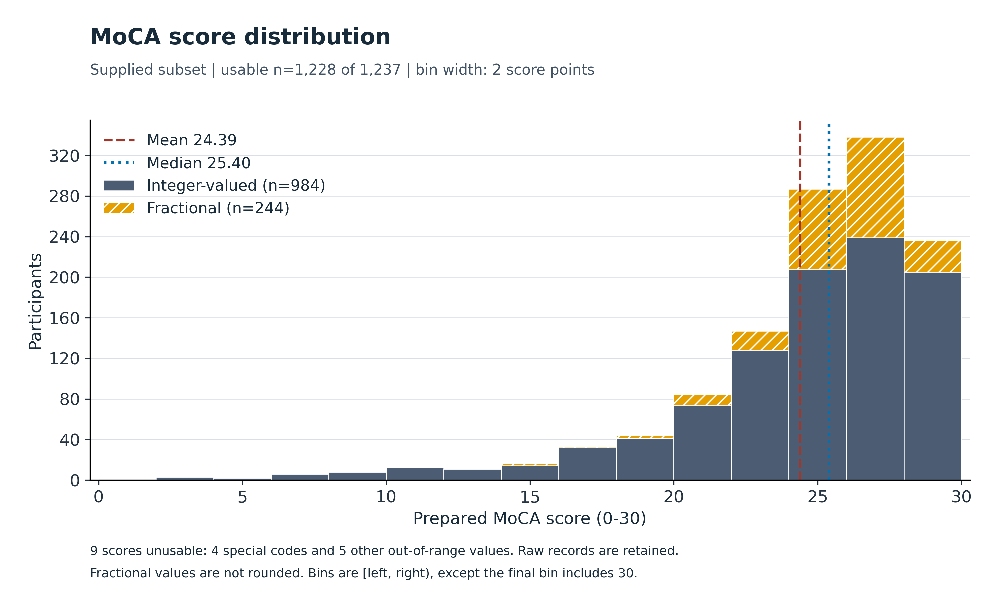
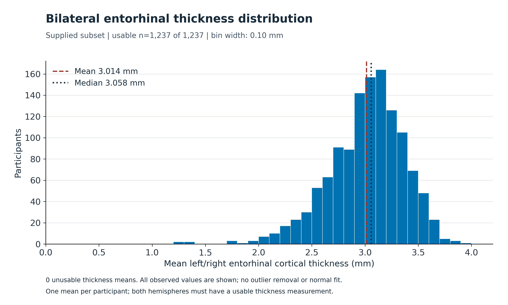
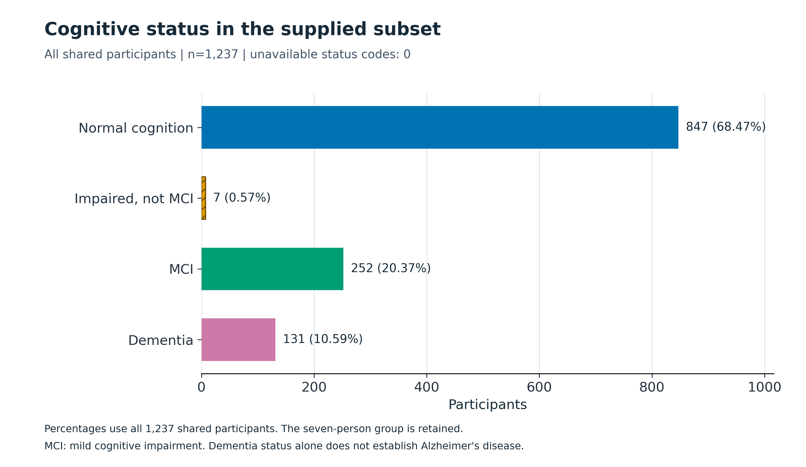
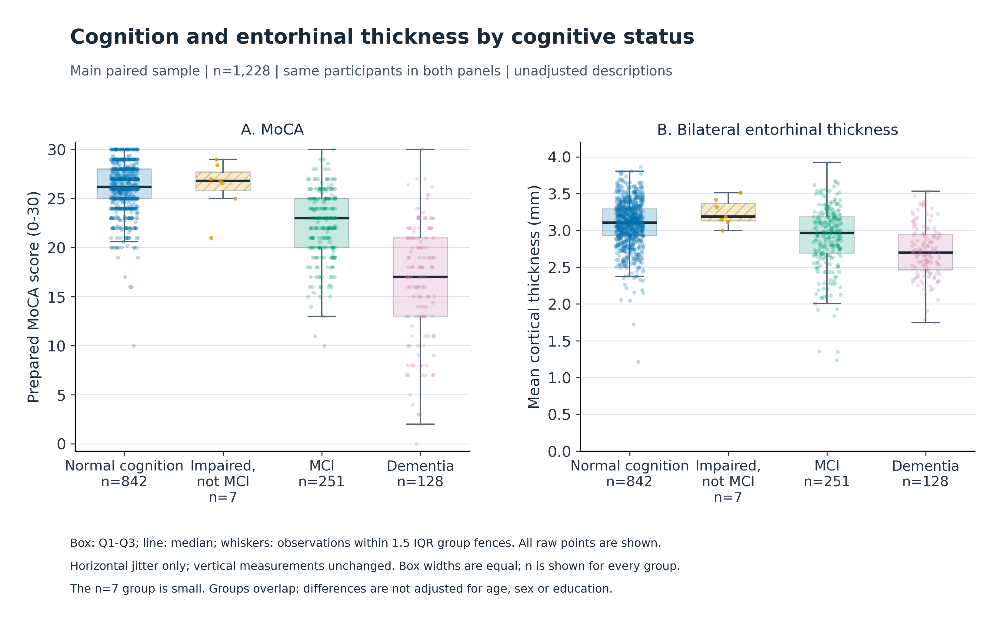

# نمودارهای فاز یک — مسیر ج

چهار شکل توصیفی با PNG با وضوح ۳۰۰ dpi و SVG برداری تهیه شده‌اند. عنوان/محورها انگلیسی و توضیح‌ها فارسی‌اند. جمعیت هر شکل و علت تفاوت تعدادها صریح است؛ داده‌ها و قواعد تغییر نکرده‌اند.

## انتخاب شکل و قواعد مشترک

دو هیستوگرام برای دو متغیر کمی اصلی، میله‌ای برای وضعیت طبقه‌ای و شکل دوپنلی جعبه/نقاط برای مقایسهٔ دو وجه در چهار گروه انتخاب شده‌اند. محورهای شمار از صفرند، دامنهٔ کامل مقادیر نمایش داده می‌شود و مدل، منحنی نرمال، KDE، آزمون، علامت معنی‌داری یا فاصلهٔ اطمینان اضافه نشده است. رنگ‌ها همراه نام، ترتیب، هاشور و نوع خط به کار رفته‌اند؛ اطلاعات فقط به رنگ وابسته نیست.

## شکل 1 — توزیع نمرهٔ کاری MoCA

**هدف و خواندن شکل:** توزیع نمرهٔ کاری UDS با هیستوگرامِ شمار افراد و بازه‌های ثابت دو امتیازی نمایش داده شده است. دو بخش ستون‌ها مکمل هم‌اند: 984 صحیح‌مقدار و 244 اعشاری درون دامنه، مجموعاً 1228 نفر. رنگ و هاشور هر دو به تشخیص بخش اعشاری کمک می‌کنند؛ صحیح‌بودن اصالت نمره را اثبات نمی‌کند. هر بازه از چپ بسته و از راست باز است؛ بازهٔ آخر شامل ۳۰ است. اعشار به نمرهٔ صحیح گرد نشده‌اند. 9 پاسخ غیرقابل استفاده از 1237 فرد در نمودار نمره وارد نیستند و در جدول مرجع باقی‌اند؛ چهار کد ۸۸ به معنی اجرا نشدن یک یا چند آیتم یا کل آزمون و پنج نمرهٔ دیگر خارج از دامنه‌اند.

**تفسیر توصیفی:** تراکم عمده در نمره‌های بالاتر و امتداد توزیع به سمت نمره‌های پایین دیده می‌شود؛ میانگین 24.39 پایین‌تر از میانهٔ 25.40 است. یک مقدار صفر و ۴۷ مقدار ۳۰ در دامنهٔ کامل حفظ شده‌اند. شکل به پهنای بازه وابسته است؛ از ظاهر آن، نرمال‌بودن، اثر کف/سقف یا علت آماده‌سازی نتیجه نمی‌شود. این نمودار دو توزیع با اندازهٔ متفاوت را به‌عنوان نمونه‌های مستقل مقایسه نمی‌کند؛ دو جزء جمع‌شوندهٔ همان نمونه را نشان می‌دهد.

[PNG با وضوح کامل](figures/01_moca_distribution.png) · [SVG برداری](figures/01_moca_distribution.svg)

## شکل 2 — توزیع میانگین ضخامت انتورینال

**هدف و خواندن شکل:** توزیع متغیر اصلی MRI، یعنی میانگین حسابی ضخامت چپ و راست، برای 1237 فرد با بازه‌های ۰٫۱۰ میلی‌متری و محور شمار نمایش داده شده است؛ مقدار غیرقابل استفاده 0 مورد است. محور افقی از صفر تا ۴٫۲ mm را پوشش می‌دهد و تمام مقدارهای مشاهده‌شده، از 1.214 تا 3.925، داخل آن‌اند. خط‌های راهنما میانگین و میانه‌اند؛ آستانهٔ بالینی نیستند. میانگین و میانه از تمام مقادیر کاری محاسبه شده‌اند، نه از مرکز ستون‌ها.

**تفسیر توصیفی:** عمدهٔ ضخامت‌ها پیرامون ۳ mm قرار دارند و امتداد به سمت مقادیر پایین‌تر دیده می‌شود؛ میانگین 3.014 و میانه 3.058 mm است. مقدارهای پایین حذف یا محورشان بریده نشده است. ظاهر توزیع، موفقیت QC یا نرمال‌بودن را ثابت نمی‌کند؛ نسخه و روش پردازش اولیهٔ MRI نامعلوم باقی است. دو نیمکره به دو فرد مستقل تبدیل نشده‌اند.

[PNG با وضوح کامل](figures/02_entorhinal_distribution.png) · [SVG برداری](figures/02_entorhinal_distribution.svg)

## شکل 3 — فراوانی وضعیت‌های شناختی در زیرمجموعه

**هدف و خواندن شکل:** نمودار میله‌ای افقی، فراوانی چهار کد NACCUDSD در تمام 1237 فرد مشترک را نشان می‌دهد؛ درصد نوشته‌شده کنار هر میله، تعداد همان گروه تقسیم بر همین مخرج است. کد غیرقابل استفاده در این متغیر صفر مورد است. ترتیب کدها حفظ شده، محور شمار از صفر شروع می‌شود و گروه کوچک با برچسب و هاشور قابل تشخیص است. MCI یعنی اختلال شناختی خفیف؛ «اختلال بدون احراز MCI» گروه مستقل کد ۲ است.

**تفسیر توصیفی:** گروه طبیعی با 847 نفر بیشترین فراوانی را دارد؛ گروه کد ۲ با 7 نفر حفظ شده و با MCI ادغام نشده است. این درصدها ترکیب زیرمجموعهٔ تحویلی‌اند و شیوع جمعیت عمومی نیستند. دمانس به‌تنهایی علت اختصاصی آلزایمر را مشخص نمی‌کند. تعدادهای این شکل با شکل مقایسهٔ زوج اصلی متفاوت‌اند، چون جمعیت مبنا متفاوت است.

[PNG با وضوح کامل](figures/03_cognitive_status.png) · [SVG برداری](figures/03_cognitive_status.svg)

## شکل 4 — مقایسهٔ توصیفی شناخت و ضخامت در گروه‌ها

**هدف و خواندن شکل:** دو پنل برای MoCA و میانگین ضخامت روی همان 1228 فرد زوج اصلی رسم شده‌اند؛ تعداد چهار گروه به ترتیب 842، 7، 251، 128 است. جعبه از Q1 تا Q3 و خط داخل آن میانه است. سبیل‌ها تا دورترین مقدار مشاهده‌شدهٔ داخل حصار ۱٫۵ IQR همان گروه می‌روند؛ سبیل کمینه/بیشینه یا فاصلهٔ اطمینان نیست. همهٔ نقاط، شامل نقاط بیرون سبیل، رسم شده‌اند و نماد تکراری جداگانه برای دورافتاده‌ها افزوده نشده است. جابه‌جایی کوچک فقط افقی با بذر ثابت 20261031 برای کاهش هم‌پوشانی است؛ نمره و ضخامت عمودی تغییر نکرده‌اند. رنگ/ترتیب گروه‌ها با شکل فراوانی هماهنگ است؛ عرض جعبه‌ها برابر است و اندازهٔ نمونه را کد نمی‌کند.

**تفسیر توصیفی:** مرکز MoCA و ضخامت در گروه دمانس نسبت به گروه طبیعی پایین‌تر دیده می‌شود، اما دامنه‌های مشاهده‌شده و بخشی از بازه‌های میانی هم‌پوشانی دارند. گروه اختلال بدون احراز MCI فقط هفت نفر دارد و الگویی یکنواخت در همهٔ چهار گروه ایجاد نمی‌شود؛ پراکندگی این گروه با n کوچک باید محتاطانه خوانده شود. این نمایش مقطعی و تعدیل‌نشده است؛ تفاوت سن، جنس و تحصیلات در جدول‌های مرحلهٔ ۷ آمده است. از این شکل، اثر مستقل ضخامت، معنی‌داری، علیت، توان تشخیصی یا تغییر طولی افراد نتیجه نمی‌شود. حصارهای درون‌گروهی این جعبه‌ها با پرچم‌های IQR کل نمونه در ممیزی تفاوت دامنه دارند؛ هیچ‌یک قاعدهٔ حذف نیست.

[PNG با وضوح کامل](figures/04_group_comparison.png) · [SVG برداری](figures/04_group_comparison.svg)

## بازتولید و ردگیری

از ریشهٔ پروژه `python3 -m src.phase1_figures` را اجرا کنید. جدول مرجع و خروجی توصیفی سازگار باید از مراحل قبل موجود باشند؛ اجرای همهٔ نوت‌بوک مراحل فعلی را به ترتیب بازتولید می‌کند. وابستگی‌های رسم در requirements.txt ثبت شده‌اند. فایل‌های خام، جدول مرجع و گزارش‌های توصیفی در این دستور فقط خوانده می‌شوند.

[متادیتای شکل‌ها](figures_metadata.json) مرز و شمار هر بازه، خلاصهٔ جعبه‌های گروهی، دامنهٔ محورها، بذر جابه‌جایی افقی، اندازه/قالب شکل، نسخهٔ کتابخانه‌ها و اثر انگشت منبع/کد/خروجی را نگه می‌دارد. هندسهٔ متن نسبت به بوم کنترل و هر چهار PNG به‌صورت تصویری بازبینی شده‌اند. خروجی‌های بیتی دقیق به نسخهٔ کتابخانه/قلم/محیط هم وابسته‌اند.

[آمار توصیفی](descriptive_statistics.md) · [جریان نمونه](sample_flow.md) · [نوت‌بوک](../../notebooks/phase1.ipynb) · [قواعد کیفیت](../../docs/QUALITY_RULES.md)
